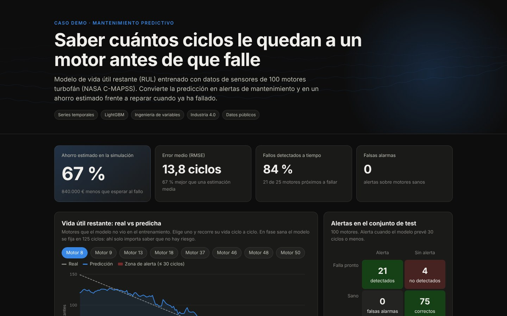

# Mantenimiento predictivo con IA: vida útil restante de motores

**Dashboard interactivo:** https://alvaromcib.github.io/ia-mantenimiento-predictivo/



Modelo que estima cuántos ciclos le quedan a un motor antes de fallar a partir de sus sensores, y convierte esa predicción en **alertas de mantenimiento** y en una **estimación de ahorro** frente al mantenimiento reactivo.

Proyecto demostrativo con datos públicos (NASA C-MAPSS FD001). No usa datos de clientes.

## Resultados (test, 100 motores)

| Métrica | Valor |
|---|---|
| RMSE | 13,8 ciclos (67 % mejor que estimar la media) |
| MAE | 9,9 ciclos |
| Fallos próximos detectados (≤ 30 ciclos) | 21 de 25 (84 %) |
| Falsas alarmas | 0 de 75 motores sanos |
| Ahorro en la simulación de costes* | 67 % frente a esperar al fallo |

\*Supuestos ilustrativos: fallo no planificado 50.000 €, intervención planificada 10.000 €. En un proyecto real se sustituyen por los costes de la planta.

## Enfoque

1. **Datos:** 21 sensores y 3 ajustes de operación por ciclo; se descartan los sensores sin variación.
2. **Variables:** medias y desviaciones móviles (5, 15 y 30 ciclos) y tendencia corto-largo plazo de cada sensor.
3. **Modelo:** LightGBM con objetivo RUL acotado a 125 ciclos (en fase sana no hay información de degradación). Validación separando motores completos, nunca filas, para evitar fugas.
4. **Decisión:** umbral de alerta, matriz de aciertos y simulación de coste, para hablar de euros y paradas, no solo de error.

## Cómo ejecutarlo

```bash
pip install -r requirements.txt
python src/train.py                 # entrena, evalúa y escribe results/results.json
python shared/build.py .         # regenera docs/index.html
```

## Cómo se aplicaría en una planta

- Datos de SCADA/PLC o históricos de sensores de bombas, compresores, motores o líneas.
- Primero un diagnóstico de los datos disponibles y de la métrica de negocio (horas de parada, coste de avería).
- Piloto cerrado sobre un tipo de activo, con alertas integradas en las herramientas que ya usa mantenimiento.

---

**Álvaro Martín Coll** · Físico · Ingeniero de IA para industria y energía · [Perfil en Malt](https://www.malt.com/profile/alvaromartincoll)

Datos: A. Saxena, K. Goebel, D. Simon, N. Eklund, *Damage Propagation Modeling for Aircraft Engine Run-to-Failure Simulation*, PHM08. NASA Prognostics Data Repository.
